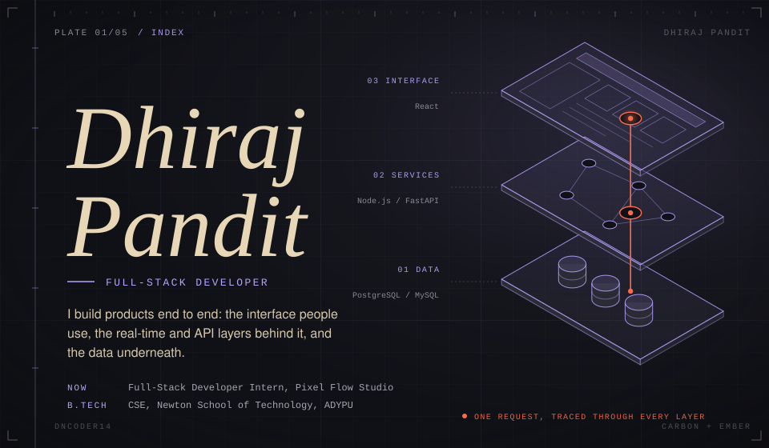
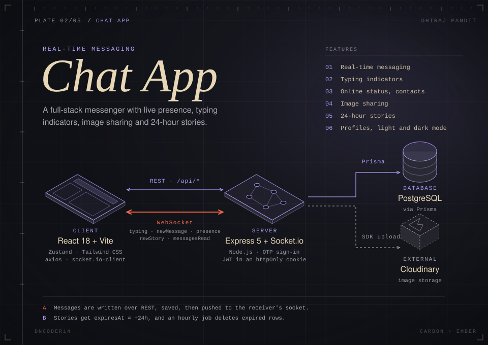
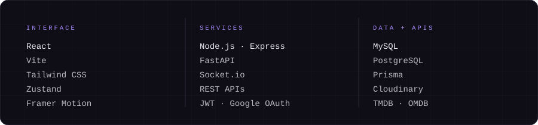

<picture>
  <source media="(max-width: 760px)" srcset="assets/hero-m.svg">
  
</picture>

<a href="https://chat-app-frontend-t3oe.onrender.com">
<picture>
  <source media="(max-width: 760px)" srcset="assets/chat-m.svg">
  
</picture>
</a>

> **Chat App** is a real-time messenger I built end to end. It has live typing indicators and online status, contact management, image sharing, stories that expire after 24 hours, profile management, and a responsive light and dark interface.
>
> React · Vite · Tailwind CSS · Zustand · Node.js · Express · Socket.io · PostgreSQL · Prisma · JWT · Cloudinary
>
> [Live demo](https://chat-app-frontend-t3oe.onrender.com) · [Source](https://github.com/dncoder14/chat-app)

<a href="https://minimus-frontend.onrender.com">
<picture>
  <source media="(max-width: 760px)" srcset="assets/minimus-m.svg">
  
</picture>
</a>

> **Minimus** is a movie and TV discovery and tracking platform. You can search and browse titles, keep watchlists, favorites and a viewing history, rate and review, and follow your viewing statistics from a profile. Sign-in works with email or Google, and an admin panel is protected by role-based access control.
>
> React · Vite · Tailwind CSS · Framer Motion · Node.js · Express · PostgreSQL · Prisma · JWT · Google OAuth · TMDB · OMDB
>
> [Live demo](https://minimus-frontend.onrender.com) · [Source](https://github.com/dncoder14/Minimus)

<picture>
  <source media="(max-width: 760px)" srcset="assets/experience-m.svg">
  
</picture>

> **Full-Stack Developer Intern, Pixel Flow Studio.** Day to day I work across React, FastAPI and PostgreSQL: REST APIs, third-party messaging integrations, document automation, delivery tracking and backend workflows.

<picture>
  <source media="(max-width: 760px)" srcset="assets/stack-m.svg">
  
</picture>

