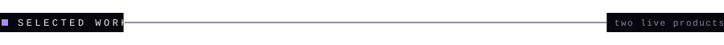
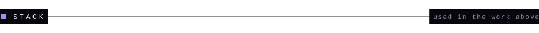

 

I build products end to end: the interface people touch, the real-time and API layers behind it, and the data underneath. Below are two deployed projects I designed and built myself, and the production work I do at Pixel Flow Studio.

 

 

**Chat App** is a full-stack real-time messenger. It has typing indicators, live online status, image sharing, stories that expire after 24 hours, contact management, JWT authentication, profile editing and a light/dark theme.

`React` `Vite` `Tailwind CSS` `Zustand` `Node.js` `Express` `Socket.io` `MySQL` `Prisma` `JWT` `Cloudinary`

[**Live demo**](https://chat-app-frontend-t3oe.onrender.com) &nbsp;/&nbsp; [Source code](https://github.com/dncoder14/chat-app)

 

**Minimus** is a movie and TV series discovery and tracking platform. Search and browse titles, keep watchlists, favorites and watched history, rate and review, see your viewing statistics, and manage everything from a personal profile. An admin panel covers the back office, and sign-in works with JWT or Google OAuth.

`React` `Vite` `Tailwind CSS` `Framer Motion` `Node.js` `Express` `MySQL` `Prisma` `JWT` `Google OAuth` `TMDB API` `OMDB API`

[**Live demo**](https://minimus-frontend.onrender.com) &nbsp;/&nbsp; [Source code](https://github.com/dncoder14/Minimus)

 

 

 

 

 

