 

I build full-stack products end to end: the interface, the API behind it, and the database underneath.

**[Chat App](https://chat-app-frontend-t3oe.onrender.com)** &nbsp;·&nbsp; **[Minimus](https://minimus-frontend.onrender.com)** &nbsp;·&nbsp; **[All repositories](https://github.com/dncoder14?tab=repositories)**

<picture>
  <source media="(max-width: 760px)" srcset="assets/sec-about-m.svg">
  
</picture>

- **Now:** Full-Stack Developer Intern at Pixel Flow Studio, working with React, FastAPI and PostgreSQL
- **At work:** REST APIs, third-party messaging integrations, document automation, delivery tracking and backend workflows
- **Studying:** B.Tech in Computer Science and Engineering at Newton School of Technology, ADYPU
- **On my own:** designing, building and deploying complete apps, from real-time messaging to media tracking

<picture>
  <source media="(max-width: 760px)" srcset="assets/sec-stack-m.svg">
  
</picture>

<picture>
  <source media="(max-width: 760px)" srcset="assets/stack-m.svg">
  
</picture>

<picture>
  <source media="(max-width: 760px)" srcset="assets/sec-projects-m.svg">
  
</picture>

### Chat App
**Real-time messaging**

Live typing indicators and online status, contacts, image sharing, and stories that expire after 24 hours. Includes authentication, profile management and a responsive light and dark interface.

<picture>
  <source media="(max-width: 760px)" srcset="assets/tech-chat-m.svg">
  
</picture>

**[Live demo](https://chat-app-frontend-t3oe.onrender.com)** &nbsp;·&nbsp; **[Source code](https://github.com/dncoder14/chat-app)**

 

### Minimus
**Movie and TV discovery and tracking**

Search and browse titles, keep watchlists, favorites and history, rate and review, and see your viewing stats. Includes profiles, an admin panel and role-based access control.

<picture>
  <source media="(max-width: 760px)" srcset="assets/tech-minimus-m.svg">
  
</picture>

**[Live demo](https://minimus-frontend.onrender.com)** &nbsp;·&nbsp; **[Source code](https://github.com/dncoder14/Minimus)**

<picture>
  <source media="(max-width: 760px)" srcset="assets/sec-experience-m.svg">
  
</picture>

**Full-Stack Developer Intern, Pixel Flow Studio**

Building across the stack with React, FastAPI and PostgreSQL: REST APIs, third-party messaging integrations, document automation, delivery tracking and backend workflows.

**[github.com/dncoder14](https://github.com/dncoder14)**

